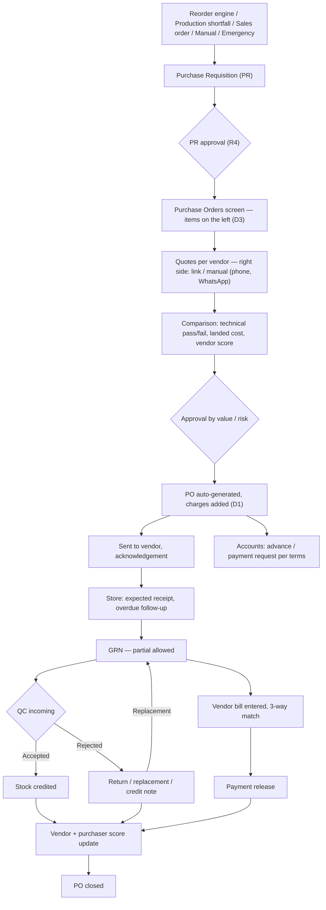

# Procurement v2 — Build Workflow

Date: 2026-10-08
Status: **Build plan for the rebuild. 27 open questions (§9), 63 resolved (§10). The purchase flow is complete (change report §32); the
open questions left are optional or belong to the outsource flow.**

Built so far (2026-10-08 / 09) — see `procurement-v2-changes-2026-10.md`:
- Payment Terms + GST off Vendor Master.
- Vendor Master v2 + the Company Admin's "Purchase & Vendor Approval" page (Phase 1 — the
  create→approve path is tested live).
- Not yet tried in the browser:
  - the RFQ/PO page
  - PO-time GST / charges / payment terms
  - Company Admin PO approval + purchase settings
  - one quotation email per vendor, the PO emailed to the vendor, the Company Admin seeing every
    PO, Quote history
  - quote validity (days) and "Bought before", the last-price check (2026-10-09)
  - manual quotations with mandatory evidence (2026-10-09)
  - fabrication: one request / card per size, ordered in pieces (2026-10-09) — needs
    `scripts/splitFabricationRequestsBySize.js` run once

## How to use this doc

- This is the plan for building Purchase again from zero, against the client's latest blueprint.
- Every unclear point is a numbered question in §9 (e.g. **W2**). Each one has a **Default**: what we
  build if nobody answers before we reach it. So no question blocks work by itself.
- When a question gets answered during the build: change its `Status` to `Resolved`, write the
  answer under it, and add a line to the Resolved log (§10).
- Build reports go in `procurement-v2-changes-2026-10.md` in this folder: one growing,
  plain-language file for this whole initiative, with one `##` section per change.
- Work that's been deliberately parked until a later phase is listed in §8a ("Carry into the PO
  rework"). Check it before starting that phase.

## Sources

1. **Client blueprint** — `Samtek_ERP_Professional_Procurement_Blueprint.txt`, v1.0, 30 Sep 2026.
   It has 30 sections plus Appendices A–C, and `§` numbers in this doc point to it.
2. **Client meeting design changes** — `खरीद प्रक्रिया में बदलाव.html` (Oct 2026). Four changes,
   referred to here as **D1–D4**:
   - **D1** — Remove Charges from Vendor Master. Charges are typed at PO time, every time.
   - **D2** — Creating a vendor and assigning its Products/Services become two separate steps.
   - **D3** — By Item and By Vendor merge into one screen: items on the left, vendors on the right.
   - **D4** — The "Quote" button is renamed. *(Changed by the client 2026-10-08: it's called
     **"Vendor Quotation"**, not "PO", and the merged page is called **"RFQ/PO"**.)*
3. **Feasibility check** (2026-10-08, against the code). Its results are in §2 and §3.
4. Earlier decisions: `../procurement-redesign-discussion-2026-09.md`,
   `../purchase-workflow-changes-2026-10-discussion.md`,
   `../procurement-purchase-restructure-changes-2026-10.md`.

---

## 1. Ground rules (apply to every phase)

- **Chain of evidence.** Every record links back to the one before it:
  PR → quote → selection/approval → PO → GRN → QC → return/bill → payment → score. No score is
  typed by hand if it can be computed from these records (§30).
- **Nothing commercial is overwritten.** A new price is a new quote version. A PO change is a new
  PO revision. The original always stays readable (§10, §14, §15).
- **Stock goes up only after QC accepts it.** That is already true today and must stay true (§17, §18).
- **`companyId` on every new model and every query.** This is the lesson from the 2026-10-06
  cross-company leak (Supplier/Purchase had only `unit`). `unit` stays as the branch, not the company.
- **Child Parts and Sub Child Parts are never Purchasable.** What they need from a vendor is job
  work (a Service), never a goods purchase.
- **English UI.** The client design file says the real software is in English.
- **Every approval goes to the Company Admin** (decided 2026-10-08). Wherever the blueprint says
  Purchase Manager, Purchase Head, Management or an "authorized committee" approves something,
  the **Company Admin** approves it instead. All of these live on one Company Admin page,
  **"Purchase & Vendor Approval"** (`/hrms/CompanyAdmin/purchase-approvals`), with one tab per
  approval type.
  - **Built:** New Vendors, Vendor Changes, Suspend / Blacklist, Watchlist.
  - **Each later phase adds its tabs here:** PR approval, vendor selection / PO, exceptions,
    price variance.
  - **Nobody approves their own request.**
- **Commercial terms are never on the vendor** (decided 2026-10-08). Payment terms, GST rate,
  charges, freight terms, Incoterm, quote validity, tax applicability and per-item MOQ / lead time /
  warranty are all decided on the quote or the PO, not stored on Vendor Master. The blueprint's
  §8 "Commercial Terms" block and the commercial columns of §7's vendor–item mapping are
  deliberately not built. The client hasn't reviewed the blueprint closely, so this is our call.

## 2. Hard limits — what we will NOT build as the blueprint words it

| Blueprint asks | Why not | What we build instead |
|---|---|---|
| Record vendor phone calls (§10) | Calls on personal mobiles never reach the ERP | A manual call-log entry (date, who, summary, outcome). Optional later: extend the existing Acefone IVR integration (`models/CallLog.js`, Leads only today) to calls made from company lines (**QT6**) |
| Read vendor quotes from WhatsApp | `services/whatsappService.js` can only send. Replies are free text or photos, and replies to a personal WhatsApp never reach us | Send the request by WhatsApp; type the price in by hand; attach a screenshot |
| Read emailed quotation PDFs into price fields | The server can't read a mailbox, and every vendor's PDF looks different | Vendor fills the token-link form (works today), or Purchase types it in and uploads the PDF as evidence |
| "Immutable" quotes and audit trail (§14) | Anyone with database access (including us) can still change records | App-level lock + versioning + a hash-chained audit log, so tampering can be **detected**, not prevented (**X4**) |
| Detect collusion (§14) | Collusion happens outside the system | Pattern flags only (§14's list). These are alerts, never accusations |
| Scores and history from day one (§11–13, §20) | No past data, and no stock movement ledger exists | Everything starts at go-live and shows "not enough history" until there is some |
| Live GSTIN/PAN verification (§8) | Needs a paid government-data API | Format + checksum validation. A paid API can come later |
| Automatic bank account check (§14) | Needs a paid penny-drop API | Manual: the Company Admin checks bank details against the uploaded cancelled cheque before approving a vendor, and approves every later bank change (built 2026-10-08, **V3**) |
| Pay vendors from the ERP (§16) | No bank payout API | Accounts marks "Paid" with the bank reference (UTR) |
| Lot/serial traceability (§17, §26) | Stock is one number per item; tracing a lot into a machine needs stock held per lot | Record batch/lot/serial on the GRN line only (**ST3**) |
| Delivery warehouse / stock per warehouse (§22) | No warehouse concept; stock is per item per company | A delivery address on the PO |
| Budget check (§26) | No budget data exists anywhere | Only if the client sets up budgets (**X1**) |
| Economic Order Quantity (§20) | No ordering or holding cost exists per item | Only if the client provides them (**R8**). Otherwise use `reorderQty` |

## 3. Phase 0 — fix these before the reorder engine can be trusted

**Update 2026-10-09:** items 1–3 below are **fixed**: issued material is no longer counted twice, reservations are per size, and stale reservations are cleaned up daily. Also fixed: an order overwriting its own reservation, a re-check counting its own claim, and Store / Production / the sales auto-check / the min-stock sweeps now use free stock. See `procurement-v2-changes-2026-10.md` §10. Items 4–5 (stock movement ledger, incoming in stock units) are still open.

The blueprint's reorder formula (§20) is
**Available + Confirmed incoming − Reserved ≤ Reorder level**. The reservation ledger
(`MaterialReservation`, `services/materialReservationService.js`) exists, but:

1. **Reservations aren't reduced when Store issues material.** An issue deducts `Item.qty`
   straight away (`controllers/inventoryController.js:3705`, `:4076`,
   `controllers/subChildPartJobWorkOrderController.js:218`). The reservation is only deleted when
   the order reaches Completed (`models/ProductionOrder.js:495`). Between the two, the same
   quantity is subtracted twice. **Fix:** reduce the order's reservation by the issued quantity
   at issue time.
2. **Fabrication reservations are per item, not per size.** `MaterialReservation` has no
   dimension-variant field, but fabrication stock and minimum stock live per size
   (`dimensionVariants[].subStock`). `getFreeQty` subtracts every size's reservations from one
   size's stock. (This is also a hidden bug in today's production cascade.) **Fix:** add a
   variant key and compute free stock per size.
3. **Abandoned orders keep their reservations.** This is already flagged in
   `../bom-hierarchy-redesign-build-2026-09.md` §19. **Fix:** audit every cancel/abandon path.
4. **No stock movement ledger.** `Item.qty`/`subStock` is changed directly from at least 8
   controller/service files. The one `StockMovement.create` call
   (`controllers/purchaseController.js:727`) imports a model that doesn't exist, so it silently
   does nothing. **Fix:** one stock service that every stock change goes through, writing a
   movement row (item, size, qty, before/after, reason, source document, user). Consumption
   history, stock-out events and the dashboards (§21) all depend on it.
5. **Incoming quantity in stock units.** Open PO quantity is in the Purchase Unit. For
   non-fabrication items, the conversion to the stock unit is typed by Store at receive time
   only. **Fix:** see **R9**.
6. **Audit log infrastructure** — append-only and hash-chained (**X4**) — plus **config masters**:
   approval matrix (**A1**), score weights (**S1**), charge names (**C4**), defect categories (**QC3**).

---

## 4. Roles

| Role (§3) | Does | Can't (§23) |
|---|---|---|
| Purchaser / Purchase Executive (Accounts roles today) | Creates vendor drafts, uploads documents, submits vendors for approval, requests suspension / blacklisting / reinstatement, collects quotes, negotiates, recommends a vendor, follows up deliveries | Approve anything; change an approved vendor's legal name / GSTIN / PAN / bank details without approval |
| **Company Admin** (replaces the blueprint's Purchase Head + Management) | Approves everything: new vendors (with a verification checklist), vendor detail changes, suspension / blacklisting / reinstatement, the watchlist; later PRs, vendor selection / PO, exceptions, price variance | Approve their own request |
| Store | Expected receipts, GRN, marks "not received", return dispatch | Change PO price or terms |
| QC | Incoming inspection: accept / partial / reject / deviation | Change PO commercial terms |
| Accounts | Payment requests, vendor bills, 3-way match, payments, bank-detail verification | Change price or vendor selection |
| Master Admin | Roles, limits, score weights, masters, audit access | — |

Mapping these to real system roles and real people is **G4**.

## 5. End-to-end flow



---

## 6. Stage by stage

### 6.1 Vendor onboarding and Vendor Master (§8, §9, §25 + D1, D2)

**Built 2026-10-08** — details in `procurement-v2-changes-2026-10.md` §2.

**Step 1 — Create (D2).** The vendor starts as a **Draft**. Fields on the form:
- **Identity and registration:** legal name, trade name, entity type, GSTIN, PAN, CIN, MSME/Udyam,
  IEC
- **Contact:** contact person + designation, phone, WhatsApp, email, alternate contact
- **Addresses:** Registered, plus Billing and Dispatch (each "same as registered" by default)
- **Business profile:** business type, OEM / authorized distributor, capacity, locations served
- **Quality and risk:** quality system, inspection / material-test certificates, risk class,
  conflict-of-interest declaration (§14)
- **Bank details, credit limit**

**Not on the form:** Products/Services, Charges (D1), Payment Terms, GST Rate or any other
commercial term (§1). Documents with expiry dates are added in Edit, once the vendor exists.

**Step 2 — Assign (D2), its own dialog.** Products (Purchasable items) and Services (job-work
steps) are picked in a separate "Products & Services" dialog with its own Save, never in the
details form:
- it opens on its own right after create, with a "Later" option
- it opens any time from the vendor card's button
- it's read-only while the vendor is under approval

The vendor–item mapping stays a plain link: no per-item commercial terms (§1). Last price and
actual lead time per item already show on the Vendor Ratings tab, from real POs.

**Step 3 — Submit for approval.** The system checks that everything needed is there:
- PAN, phone, email, registered city/state/pincode, full bank details, risk class
- the conflict-of-interest answer
- at least one Product or Service
- documents: PAN Card, Cancelled Cheque/Bank Proof, and a GST Certificate if a GSTIN is entered

If anything is missing, Purchase gets the list. While it's under review the vendor is read-only;
Purchase can withdraw it to edit.

**Step 4 — Company Admin approves** on the New Vendors tab, after ticking a verification checklist
(GSTIN, PAN, bank vs cheque, documents genuine) and confirming the risk class. Rejecting needs a
reason, which Purchase sees, and they can fix and resubmit.

**Lifecycle (as built):**
- Draft → Pending Approval → Approved / Rejected
- Approved → Suspended / Blacklisted, by request + Company Admin approval → Reinstate
  (request + approval) → Approved

For an Approved vendor, the stage is **derived live from the existing vendor rating**
(`vendorRatingService.js`) and never stored:
- **Watchlist** — rating < 3.0 over ≥ 5 events. Listed on the Company Admin's Watchlist tab with a
  direct "Suspend" action; nothing happens automatically.
- **Probationary** — fewer than 3 POs with a received line.
- **Active** — otherwise.

Reworking the rating to the client's weighted formula (§11) is still a separate task (§6.13).

**Who can be used:** only **Approved + active** vendors can be quoted or given a PO. This is
enforced server-side at:
- By Item's vendor list and quote creation
- By Vendor's list and PO creation
- the legacy RFQ lists
- choosing a vendor for a QC exchange

Invoices, payments and returns are not gated: money owed to a suspended vendor still gets paid.

**After approval:** a change to legal name, GSTIN, PAN or bank details goes to the Company Admin
(Vendor Changes tab), and the old values stay in use until it's approved. Every other edit saves
directly. Every action lands in the vendor's own history (`Supplier.activity`). Document expiry
reminders run daily at 9:15 AM (30 days before, and on the day).

Open: V5, V7.

### 6.2 Requirement — reorder engine and PRs (§4 steps 1–3, §5, §20)

**Sources of a PR:**
- **Reorder engine** — after Phase 0, it compares free stock + confirmed incoming against the
  reorder level (**R1**). Plain items are checked per item; fabrication items per catalog size.
- **Production shortfall** — the Machine / Child Part / Sub Child Part cascade (already
  reservation-aware).
- **Sales order** — an out-of-stock trading product.
- **Manual** — Store or other departments.
- **Emergency** — needs a reason and approval (**R6**).
- **QC replacement** — after a rejection.
- **Job work** — only if **G3** says so.

**A PR carries:**
- item, required qty + unit, priority
- **required-by date** (missing today, **R5**)
- source + reference (sales order / production order / project)
- snapshot at creation: current stock, reserved, open PO qty, minimum, reorder level
- specification / drawing revision where relevant

Before a new PR is created, the screen shows any existing open PR and PO quantity for the item
(**R7**).

**PR approval:** **R4**. Statuses: Draft → Pending Approval → Approved → (Partially) Ordered →
Received → Closed, plus Rejected / Cancelled (**W9** decides "Partially Ordered").

Open: R1–R9.

### 6.3 RFQ/PO page — the merged screen (§6 + D3, D4)

**Built 2026-10-08** as **"RFQ/PO"** — details in `procurement-v2-changes-2026-10.md` §5. What
changed from the plan below, per the client: the mock was dummy, so the real logic stays (one
quote per item per vendor via "Vendor Quotation", one PO per vendor); vendors are ranked with
k/N even on fresh load (N = all listed items); search and filters pull matches to the top instead
of hiding the rest; Select all / Clear helpers. The text below is the original plan.

**Updates 2026-10-09:**
- **One card per fabrication size,** ordered in pieces (§9 of the change report).
- **Blueprint §6 stock context on the item cards is built** (§12): a stock button (Stock ·
  Reserved · Free · Incoming · Min ⚠) that opens a popup with what each request is for, the
  reserving orders and the open POs. It uses the fixed reservation ledger (§10).
- Store has a **Reservations** page (§11).

The working name is "Purchase Orders" (**W1**). One page replaces the By Item and By Vendor tabs.
**Left = information and filtering. Right = the actual quoting and ordering.**

```
+-------------------- By Item (left) --------------------+ +-------------------- By Vendor (right) --------------------+
| [x] Tool-A  Tool-01                                     | | 2 vendors cover at least one selected item  [Sort: Coverage]|
|     3 pending requests . combined 20 Pieces             | | +-------------------------------------------------------+ |
|     PR044  Auto Reorder (Low Stock)       10 Pieces     | | | sujeet   [Active][Cheapest][Fastest]       [2/2 items] | |
|     PR168  Manual (Store Transfer)         5 Pieces     | | |  Tool-A     Rs/unit [ 100 ]  [PO]                      | |
|     Select requests (3 of 3 selected)                   | | |  NUT Bolts  Rs/unit [   7 ]  [PO]                      | |
| [x] NUT Bolts  NB-012                                   | | |  + Add Charge                                          | |
|     ...                                                 | | +-------------------------------------------------------+ |
| [ ] SS Sheet  SSS-001                                   | | | rahul vendor                               [2/2 items] | |
|     ! Only 2 vendors on file for this item              | | |  ...                                                   | |
+---------------------------------------------------------+ +-----------------------------------------------------------+
```

**Left — items to buy:**
- One card per item, combining every open PR for it. For fabrication items, all sizes of one
  base item combine into one kg total (decided 2026-10-06).
- **All pending PRs are selected by default (D3).** Purchase can remove a PR (hold it back) or
  add it again later through "Select requests". Once any vendor has been quoted, changing the
  selection asks for confirmation first, and the combined quantity refreshes to the new sum
  (still editable). Late-arriving PRs: **W8**.
- The card shows the combined quantity, each PR with its source badge and quantity, and a
  **fewer-than-3-vendors** warning (**W11** decides warning vs block).
- Clicking cards selects several items at once.

**Right — vendors:**
- With nothing selected: every eligible vendor that supplies something purchasable (**W5**).
- With items selected: only vendors covering at least one selected item, **grouped by coverage**
  (all N first, with a "k/N items" badge, then N−1, …). Vendors covering none drop out.
- Within a coverage group, the user picks the sort: Price / Rating / Fastest delivery (**W6**).
  Coverage is always the first sort key.
- Each vendor card has one quote line per selected item it covers: a price field (₹/unit) and a
  **"PO" button (D4)**, plus Cheapest/Fastest/Active badges (**W7**) and **"+ Add Charge" (D1, C1–C4)**.
- What the price field and the PO button actually create — quote, selection, draft PO — is the
  biggest open question: **W2**, **W3**, **W4**.

**PRs tab:** stays as the full list of requests with quote status. Its "Quote" button becomes
"PO" (D4) and opens this screen with that item selected (**W10**).

Open: W1–W11.

### 6.4 Quote collection and negotiation (§10)

**Built 2026-10-08** (details in `procurement-v2-changes-2026-10.md` §6):
- **Email:** one request per vendor for several items, on a multi-item page with charges and
  terms. One submission only (QT5 resolved).
- **Manual:** stays per item, now with an optional GST %.
- A newer quote replaces the vendor's previous one for the item ("Replaced").
- **Quote history** shows every version, on RFQ/PO, on Purchase Orders and on the Company Admin's
  PO approvals.

Built 2026-10-09: **quote validity** (days, Purchase Settings) blocks an expired quote from becoming
a PO (QT4 resolved). **"Bought before"** compares every quote with what we last paid that vendor
on a delivered purchase, and the tag opens every vendor's prices.

Built 2026-10-09: **manual quotes need evidence** (QT2 resolved), and a revised manual price needs
a reason.

Still open: QT1, QT3 (email re-quotes), QT6. The text below is the original plan.

**Channels:**
- **Email link** — the vendor fills the public token form (exists today; extend it with the new
  fields, **QT5**).
- **Manual** — Purchase types it in after a phone call, WhatsApp, a visit or a PDF. The channel
  and the date are recorded every time.

**Quote fields:**
- unit price, discount, GST rate + included/excluded
- freight / other charges (**C1**), MOQ
- lead time / promised delivery date, payment terms + credit days (**QT7**)
- warranty, validity, brand/model, deviation from spec, installation/service charges
- **landed price** — computed, not typed

Which fields are mandatory: **QT1**.

**Evidence:** PDF, screenshot or email attachment (**QT2**).

**Versions:** every change is a new version with old price → new price, date, who, the vendor
contact, how they were contacted and the reason. The original quote is never overwritten
(**QT3**).

**Expiry:** a quote past its validity can't become a PO (**QT4**).

**Quantity:** a quote's quantity is frozen. If the item's combined quantity changes later, the
quote is marked stale. A manual quote can be re-synced at the same rate; an email quote must be
re-quoted (decided 2026-10-06).

Open: QT1–QT7.

### 6.5 Comparison and vendor selection (§11, §12, Appendix A)

**Built 2026-10-09: the vendor selection check at PO time** (change report §13). It is a price-only
first step; the weighted score below is still to come.
- Checked per PO, for that PO's vendor.
- **Competition:** each item must have been **asked** of at least min(company minimum, approved
  vendors that supply it). An emailed request or a manual quote counts, even unanswered.
- **Cheapest on landed cost:** price + GST + the vendor's quoted charges, once per quotation,
  among vendors who quoted every item of the PO.
- **Item-level cheaper prices** are hints only.
- **A failed check** needs a reason (fixed list + note) and goes to the Company Admin **whatever
  the PO value**. The check is saved on the PO.
- **Manual quotations now carry the vendor's charges + payment terms**, so both channels compare
  the same way.

1. **Technical check first** — pass/fail per quote (**S3**). A failed quote is excluded from
   price ranking.
2. **Landed cost** = unit price − discount + GST (if excluded) + the item's share of charges +
   freight. Lowest landed cost among technically passed quotes = 100 price points; others score
   proportionally.
3. **Vendor score** (default weights, **S1**):
   - price 25, quality 25, delivery 15, credit terms 10
   - warranty/service 10 (**S6**), technical 10, documentation/response 5
   - Quality, delivery, warranty and response come from history (rolling 12 months, recent
     weighted more, **S4**). A vendor with no history gets **S2**.
4. **Recommendation.** The system marks the top vendor. If Purchase picks a lower-scored vendor,
   a reason is required and it goes to approval. The calculated score is kept as it was (§11).
5. **3-vendor rule (§7).** Fewer than 3 eligible quotes → exception reason (sole source, OEM,
   customer spec, emergency, no market) + approval (**W11**).

This replaces today's simple average rating (`services/vendorRatingService.js`). Its data sources
(on-time delivery vs each line's own expected date, QC pass/fail incl. partial rejections, raw
unit price history) carry over as inputs.

Open: S1–S6.

### 6.6 Approval (§23, Appendix C)

- What gets approved is the **vendor selection**. Once approved, the PO is generated already
  approved, with no second approval (**A2**).
- Approval goes to the **Company Admin**, as a new tab on the Purchase & Vendor Approval page
  (§1). Whether value thresholds still matter, e.g. small POs needing no approval at all, is
  **A1**. The 3-vendor rule + budget (if any, **X1**) still apply. Single-source and other
  exceptions always need Company Admin approval.
- The approver can't be the person who made the selection (**X3**). The vendor tabs already
  enforce this.
- Delegation when the approver is away: **A4**.

Open: A1–A4.

### 6.7 PO generation, charges, sending (§15 + D1)

**Generated from the approved selection — nothing retyped:**
- vendor, billing/shipping address, items, qty + unit, price, GST, discount
- **per-line delivery date** (from that line's quote; already built this way)
- payment terms, warranty, QC requirement
- links to the PRs, quotes and approval

**Payment terms and GST — entered at PO creation (decided 2026-10-08).** They're no longer on
Vendor Master. Purchase sets them on the PO:
- Advance %, Balance %, Credit Days, Payment Notes — per PO
- GST rate — per PO line (different items can carry different GST)

The PO's credit days drive the bill's due date and the payment requests (§6.8). What exactly has
to be built and rewired is listed in §8a.

**Charges (D1):** added on the PO, not from Vendor Master. The name/amount shape and the GST on
them are open (**C1–C4**). Transport: by vendor or company (**C5**).

**One vendor, several items:** a PO can carry several items from one vendor (vendor-wise
buying, §6).

**Statuses:** Draft → Pending Approval → Approved → Sent to Vendor → Acknowledged → Partially
Received → Fully Received → QC Pending → Closed / Cancelled.

**Sending:** email with a PDF and an acknowledgement link (**P2**).

**Changes:** any change after approval creates a revision, and some changes need re-approval
(**A3**). A PO price above the approved quote needs a variance reason + approval (§14).

**Cancel:** rules in **P3**.

Open: P1–P4, C1–C5.

### 6.8 Accounts — payment requests, vendor bill, 3-way match (§16)

**Built 2026-10-12** (change report §22–§25), from the client's answers in
`accounts-bill-ledger-payments-2026-10.md`:
- the PO is the bill
- the advance, with delivery days counting from it
- QC pass → payable; an optional mid payment
- full acceptance → due by credit days
- QC rejections settled by the vendor's answer
- a real ledger per company + unit

(It was on hold from 2026-10-10 until the client answered.)

**Bug found 2026-10-09 — to fix first in the next session (with the invoice timing):**
- **The intent:** `createAutoPurchaseInvoice` runs when a PO is ordered and is meant to post
  Dr Purchase Account + Dr Input GST / Cr Accounts Payable.
- **What happens:** it silently skips, because no unit has accounts with those exact names. 0
  invoice postings exist.
- **Vendor payments and QC returns only DEBIT Accounts Payable.** So it goes negative: Alpha Unit
  shows −₹90,000 (a ₹40,000 QC return + a ₹50,000 payment, July data).
- **Posting at PO time would be wrong anyway.** A PO is a commitment; the purchase should be
  booked on receipt or on the vendor's bill.
- **`Account` has no companyId**, only a unit name, so two companies with the same unit name
  would share accounts.
- **Already ready for the fix:** a PO cancellation reverses an invoice posting proportionally if
  one exists, and records a vendor credit for what was paid (change report §14). Using that
  credit is still to do.

1. **On PO approval**, a payment request is created for each payment term:
   - Advance
   - Against Dispatch (**AC3**)
   - Against GRN
   - Against Invoice
   - Credit days
   - Milestone
2. **An advance** is recorded against the PO and adjusted against the vendor bill later (**AC2**).
3. **Vendor bill.** Accounts enters the vendor's *actual* bill: number, date, lines, tax. That
   replaces today's auto-invoice copied from the PO (**AC1**), because a copy of the PO always
   "matches" and makes the 3-way match pointless.
4. **3-way match** — PO vs GRN (accepted quantity) vs bill. For items that need QC, only
   accepted quantity is payable (**AC4**). Tolerances: **AC5**.
5. **Statuses:** Requested → Under Review → Approved → Scheduled → Paid / Partially Paid /
   Rejected → Reconciled.
6. **Reminders** before the due date (**AC7**). A credit-limit warning or block at PO time
   (**AC6**).

Already built and reusable: payments targeted at specific invoices (`VendorPayment.allocations[]`)
and `getVendorOutstanding`.

**Built 2026-10-12** from the client's answers (change report §22–§25;
`accounts-bill-ledger-payments-2026-10.md`). The model differs from the plan above:
- **The PO is the bill.** There's no separately typed vendor bill and no 3-way match.
- **Payment:** the advance when the PO is placed, then the full payment Credit Days after
  everything is received and QC-passed, with an optional part payment for accepted material.
- **QC rejections** are settled by the vendor's answer (replace / refund / credit / refused).
- **The vendor's own invoice number** is recorded at receive.

Open: AC6 only (credit limit: today a warning at PO time).

### 6.9 Store — expected receipts and follow-up (§17)

**Built 2026-10-10** (change report §16):
- Store is notified when a PO becomes real.
- Overdue / Due today / Due in 3 days views.
- A daily overdue alert to the PO's creator.
- Revised dates with a reason, kept in the line's history.
- The vendor score uses the original date (ST5 as default).
- Not built: Store's "Not Received" confirmation and the 3-days / 1-day-before alerts. Overdue only, for now.

- **Store dashboard:** Due Today, Due Soon, Overdue, Partially Received, Received – Awaiting QC,
  Rejected – Return Pending.
- **Due-date alerts** go to Store + Purchase 3 days before, 1 day before, and when overdue
  (§24, **X7**).
- **Overdue:** on the committed date, the line is flagged and Store confirms "Not Received". A
  follow-up task goes to the purchaser (**ST4**).
- **Revised dates:** the purchaser records old date → new date, reason and vendor evidence. The
  delivery score still measures against the **original** committed date (**ST5**).

Open: ST4, ST5, ST6.

### 6.10 GRN — goods receipt (§17)

- **One GRN per vendor delivery**, with lines against PO lines.
- **Partial receipt is allowed**; the remaining quantity stays open on the PO line. Today a line
  can only be received once, so this is new.
- **Recorded per line:**
  - received qty, shortage / excess (**ST1**), packaging condition
  - batch / lot / serial (record only, **ST2**, **ST3**)
  - transporter / vehicle, challan number, documents and photos (**ST7**)
- **Stock buckets:**
  - **QC Hold** = received but not yet decided.
  - **Usable** = credited on QC accept.
  - **Rejected / Return** = waiting to go back.

  These are computed views; no second stock number is needed.
- **Unit conversion** is skipped when the purchase unit equals the stock unit (already built).
- **Splitting a combined line:** when one PO line covers several PRs, the received quantity is
  split across them in proportion to what each PR ordered, so each PR keeps its own QC record
  (decided 2026-10-07).

Open: ST1–ST3, ST7.

### 6.11 QC incoming (§18)

- **A QC inspection is created automatically** from each GRN line for items needing QC (**QC1**).
- **Checklist:** the item-specific checklist (`QCItemChecklist`: required value, tolerance,
  actual value, pass/fail, remarks), plus photos/evidence (**QC4**).
- **Outcomes:**
  - Accepted
  - Partially Accepted
  - Rejected
  - Conditional Acceptance / Deviation Approved (**QC2**)
- **Each rejection records** a defect category + severity (**QC3**). These feed the vendor's
  quality score.
- **Accepted quantity** → stock credited (through the Phase 0 stock service).
- **Rejected quantity** → return workflow. Purchase, Store and Accounts are notified.

Open: QC1–QC4.

### 6.12 Return / replacement (§19)

**Built 2026-10-12** (change report §24) in a simpler form than the plan below:
- A QC rejection waits for the vendor's answer, recorded by Purchase: **replace / refund / credit /
  refused**.
- A replacement comes on the same PO line, with a new receive and a new QC.
- Refund and credit settle the advance paid on the rejected part.
- No automatic vendor email.

**Not built:** return freight (**RT2**) and a return challan / gate pass (**RT4**).

The original plan, for reference:

1. **Return request** — created from the QC rejection: qty, defect, evidence, reason.
2. **Vendor notified** — the existing one-click exchange email can be reused (**RT3**).
3. **Return authorization** from the vendor.
4. **Store dispatches** with a return challan (**RT4**). Freight responsibility: **RT2**.
5. **Vendor confirms** receipt.
6. **Replacement or credit note** (**RT1**). A replacement goes through a **new GRN + new QC**.
   The old rejection is never flipped to accepted.
7. **PO / bill reconciliation.**

The vendor score records the severity and how long the return took to close.

Open: RT1–RT4.

### 6.13 Vendor and purchaser scores (§11–13)

- **Vendor score** is recalculated after every eligible event (GRN, QC, return closed, payment
  terms). Status bands are suggestions to the Company Admin and never applied automatically
  (§12, **V4**). **Built in a first form (2026-10-08):** Probationary / Watchlist derived from the
  existing simple rating (§6.1). When the weighted score below is built, those stages switch to
  it.
- **Purchaser score** measures process quality, not cheapest price:
  - RFQ coverage 15, quote completeness 10, landed-cost discipline 15, delivery follow-up 15
  - quality outcome 15, documentation 10, PO accuracy 10
  - relationship process 5 and policy compliance 5 — these two can't be computed and are
    entered by a manager (**S5**)
  - Exceptions, emergency purchases, single-source purchases, late follow-ups and amendments
    count against it.

### 6.14 PO closure (§4 step 20)

A PO closes only when every line is fully received **and** QC'd, every return/replacement is
closed, and the bill is matched and paid (or the balance is formally written off). Material
arriving is not enough.

### 6.15 Cross-cutting

- **Notifications and escalations (§24):** every event in §24's list, through the existing
  `Notification` model + `services/notificationService.js` + cron. Channels: **X7**.
- **Audit log (§14, §22):** **built 2026-10-10 for the PO's life** (change report §15) —
  append-only in the app, viewed by the Company Admin and the "Purchase Audit Log" permission. The
  other areas below (vendor, quote, payment request, GRN, QC, return) and the hash chain (X4) are
  still to do.
  - every create/edit/approve on vendor, quote, selection, PO, payment request, GRN, QC, return
  - stores old value, new value, user, IP address and time
  - append-only, hash-chained (**X4**)
- **Fraud and anomaly flags (§14):** management-only alerts, thresholds configurable (**X5**):
  - same vendor keeps winning despite a materially higher price
  - repeated last-minute quote changes
  - identical quotes from different vendors
  - frequent single-vendor exceptions
  - unusual price jumps
  - POs split just below an approval limit
  - repeated emergency purchases
  - the same purchaser keeps picking the same vendor
- **Separation of duties (§23):** **X3**.
- **Blacklist / suspension (§25):** evidence, reason, approver, start date and review date are
  required. A blacklisted vendor can't receive a quote request or PO until reinstated (**X6**).
- **Other controls (§26):**
  - last-price comparison + price-variance alert on every quote — **built 2026-10-09 as "Bought
    before"**:
    - **source:** what we paid on earlier **delivered** purchases only (user), same unit, before
      GST
    - **the check:** each quote vs **that vendor's own** last bought price. Amber at or above the
      warning % set in Purchase Settings (default 10%).
    - **the pop-up:** clicking the tag shows every vendor's last / lowest / average / deliveries,
      and the quote's % against each
    - **where:** the RFQ/PO vendor rows (plus the all-vendor summary on the item cards), the PO
      review, and the Company Admin's PO cards
    - Vendor Ratings reads the same numbers
    - a warning only, never blocks
    - "Quote history" was renamed "All quotes" (offers) so it isn't confused with this (paid)
  - duplicate purchase detection
  - vendor concentration report
  - document expiry alerts
  - rate contracts for recurring items (Phase 9)
  - cost-centre / project tagging (**X2**)
  - budget check (**X1**)
- **Dashboards (§21):** Purchase, Vendor, Purchaser, Store, Management (**X9**).

---

## 7. Status flows (§29)

| Record | Flow |
|---|---|
| PR | Draft → Pending Approval → Approved → (Partially) Ordered → Received → Closed / Rejected / Cancelled |
| Quote | Requested → Received → Revised (new version) → Selected / Not selected / Expired |
| PO | Draft → Pending Approval → Approved → Sent → Acknowledged → Partially Received → Fully Received → QC Pending → Closed / Cancelled |
| GRN line | Received → QC Pending → Accepted / Partially Accepted / Rejected / Deviation Approved |
| Return | Requested → Vendor Notified → Authorized → Dispatched → Vendor Received → Replaced / Credit Note → Closed |
| Payment request | Not Requested → Requested → Under Review → Approved → Scheduled → Paid / Partially Paid / Rejected → Reconciled |
| Vendor | Draft → Under Verification → Approved → Probationary → Active → Watchlist / Suspended → Blacklisted → Reinstatement Review → Active |

## 8. Build phases

Each phase is planned before it's built (plan → build, the standing preference on this project)
and gets its own section in `procurement-v2-changes-2026-10.md`. Under **Answer first** are the questions that change
the data model for that phase, so they're worth asking the client before the phase starts. Every
other question can be settled while building that phase.

| Phase | Builds | Answer first |
|---|---|---|
| **0** | Reservation fixes, stock movement ledger, audit-log infra, config masters (§3) | G1, R1, R9, X4 |
| **1** | Vendor Master v2 (D1, D2), documents, verification, approval/status, vendor–item mapping — **built 2026-10-08** (Company Admin approvals, §6.1) | ~~V1, V3, V6~~ resolved |
| **2** | PR v2 (required date, snapshot, approval), reorder engine on the new formula, duplicate warnings | R4, R5, W9 |
| **3** | Purchase Orders screen (D3, D4), quote collection, versions, evidence, landed cost | W2, W3, C1, QT1 |
| **4** | Comparison, vendor score, approval matrix, auto PO, charges, payment terms + GST at PO time (§8a), send + acknowledgement, PO revisions | S1, A1, A2, C2, P5 |
| **5** | Store expected receipts, overdue follow-up, GRN with partial receipt | ST1, ST4 |
| **6** | QC incoming on GRN lines, defect severity, deviation, return/replacement | QC1, QC3, RT1 |
| **7** | Payment requests per term, vendor bill, 3-way match, reminders, credit limit | AC1, AC4, AC6 |
| **8** | Vendor score history, purchaser score, communication log | S5, S6 |
| **9** | Fraud flags, notifications/escalations, dashboards, rate contracts, cost-centre tagging | X5, X7, X9 |

Pieces of the current system to reuse wherever the shape fits (**G1**):
- `Notification` + `notificationService`, `emailService`, `whatsappService` (send-only)
- `node-cron`, `multer` uploads
- `QCItemChecklist` / `QCJob`, `MaterialReservation`, `ItemLeadTimeStats`
- the public vendor token form (`VendorBidForm.jsx`)
- `checkPermission(module, feature, action)`
- `VendorPayment.allocations[]`, `getVendorOutstanding`
- the item-group combining logic (`ItemQuoteGroup`)

## 8a. Carry into the PO rework

**Done 2026-10-08** — both items below were built in the RFQ/PO phase: payment terms, GST and
charges are entered on the PO; every reader was rewired to the PO; the vendor fields,
`vendorChargesService.js` and its call sites were removed; the old data was dropped
(`scripts/dropVendorCommercialFields.js`, 3 vendors). Kept below for the record.

Things taken off Vendor Master ahead of time. Their backend was deliberately left running, so the
PO rework (Phase 4) has to finish each one. Check this list before planning Phase 4.

**1. Payment Terms + GST Rate** — removed from the Vendor Master form on 2026-10-08
(`procurement-v2-changes-2026-10.md` §1).
- **Build on the PO:**
  - Advance %, Balance %, Credit Days and Payment Notes per PO
  - GST rate per PO line (where it defaults from: **P5**)
  - shown and editable in the PO review step before creating
  - stored on `Purchase` (new fields)
- **Rewire these readers** from `Supplier` to the PO:
  - `purchaseController.js` `createPurchase` — line GST from `supplierDoc.gstRate`
  - `ByVendorTab.jsx` `previewGst` — the client preview from `vendor.gstRate`
  - `purchaseInvoiceController.js` `createAutoPurchaseInvoice` — due date from `Supplier.creditDays`
    (or from the vendor bill, if **AC1** replaces the auto-invoice)
  - `purchaseInvoiceController.js` `getVendorOutstanding` + `VendorPayments.jsx` — the advance
    hint from `Supplier.paymentAdvancePercent`. It needs to come per invoice from that invoice's PO.
- **Then drop the old fields** from `Supplier.js`: `paymentAdvancePercent`,
  `paymentBalancePercent`, `creditDays`, `paymentNotes`, `gstRate`.
- **Until then:** vendors that already had values keep using them. New vendors get GST 0 on their
  POs and a 30-day due date.
- `creditLimit` stays on `Supplier` — it's a vendor-wide cap, not a per-order term.

**2. Charges (D1)** — removed from the Vendor Master form on 2026-10-07
(`../purchase-workflow-changes-2026-10-discussion.md`, Change 1).
- **Build:** charges entered by hand on the PO (**C1–C4**).
- **Then remove:**
  - `Supplier.charges`
  - `services/vendorChargesService.js`
  - its 4 call sites: `purchaseQuoteController.createQuote`,
    `itemQuoteGroupController.createQuoteForGroup`/`syncBidToGroupQuantity`,
    `rfqController.submitBidByToken`, `purchaseController.createPurchase`
  - `ByVendorTab.jsx` `previewCharges`

---

## 9. Open questions

Format: question → why it's unclear → **Default** (what we build if unanswered) → Status.

### General

**G1. Build in place, or new modules alongside?**
Existing models (`Supplier`, `PurchaseRequest`, `Purchase`, `VendorBid`, `ItemQuoteGroup`,
`PurchaseInvoice`) cover parts of this.
**Default:** evolve them in place where the shape fits; add new models only for what's missing
(GRN, payment request, quote versions, audit log, scores). Also confirm the current purchase data
is still test data — it was wiped and reseeded with 10 PRs on 2026-10-06.
Status: Open

**G2. What must be live for the first release?**
The blueprint lists 8 phases.
**Default:** Phases 0–6 (through QC and returns). Accounts, scores and controls follow.
Status: Open

**G3. Is job work / outsourcing part of this flow now?**
§5 puts Service/Job Work in the same PR → quote → PO chain. Out Source Work is a separate page
today with no vendor, and the job-work cost design is deferred until the vendor system lands.
**Default:** build for goods first, but keep the PR/quote/PO models able to hold a service line.
Job-work POs wait for confirmation.
Status: Open

**G4. Who are the real people for each role in §4, and which system roles map to them?**
The approval matrix and separation of duties both depend on it. How many people work in Purchase?
**Default:** map to existing roles. Every approver role is now the Company Admin (§1), so only
the Purchase side (who creates vendors, quotes, follows up) still needs mapping. Accounts roles do
it today.
Status: Open

### Vendor

**V1. Must a vendor be approved before it can be asked for a quote?**
§9 says yes. It may be heavy for a small team.
**Default:** Purchaser creates (Draft) → Purchase Head approves → Probationary for the first 3
POs → Active.
Status: **Resolved 2026-10-08** — yes. Draft → Submit → **Company Admin** approves (with a verification
checklist). Probationary is derived: fewer than 3 POs with a received line. Built (§6.1).

**V2. Which documents are mandatory, and which have expiry dates?**
**Default:** GST certificate + PAN mandatory. MSME, ISO and authorization certificates optional.
Expiry tracked for ISO, authorizations and product certificates.
Status: **Resolved 2026-10-08** — built with this rule — needed for approval: PAN Card, Cancelled
Cheque/Bank Proof, and a GST Certificate only if a GSTIN is entered (unregistered small vendors
exist). Any document can carry an expiry date; reminders go out 30 days before and on the day.

**V3. Who can edit vendor bank details, and who are the two approvers for a change?**
**Default:** Accounts edits; Purchase Head + Accounts Head approve. A purchaser can never approve.
Status: **Resolved 2026-10-08** — Purchase (Accounts roles) edits. On an approved vendor, a change to bank
details **or legal identity (legal name, GSTIN, PAN)** goes to the **Company Admin** and the old
values stay live until approved. The "two approvals" are the requester plus the Company Admin, who
can never be the same person. Built.

**V4. Score thresholds for Watchlist / Probation / Suspension suggestions?**
**Default:** below 60 → Watchlist suggestion; below 45 → Suspension review. Suggestions only,
never automatic.
Status: **Resolved 2026-10-08, updated 2026-10-13 (§30):**
- **Watchlist:** the **vendor score** (out of 100) **below 60** (editable by the Company Admin) with
  at least 5 deliveries / QC checks, or a vendor that refused to settle a QC rejection in the last
  90 days. The Company Admin is notified once.
- **Probationary:** fewer than 3 received POs.
- Nothing happens automatically: the Company Admin can suspend from the Watchlist tab.

(Until 2026-10-13 this used the old 1–5 rating below 3.0.)

**V5. Drop the old fields — manual 1–5 rating, free-text Categories tags, `supplierType`?**
**Default:** yes. The computed score replaces the rating; the item mapping replaces the tags.
Status: Open

**V6. Vendor–item mapping fields — automatic or typed?**
Should last price, lead time, MOQ and warranty per vendor+item update from real POs, or be typed?
**Default:** last price and actual lead time update automatically from received POs; MOQ, warranty
and quoted lead time are typed by the purchaser.
Status: **Resolved 2026-10-08** — no commercial fields on the vendor–item mapping at all (§1: the quote or
PO decides MOQ, lead time and warranty). Last / average / lowest price per item already come from
real POs on the Vendor Ratings tab.

**V7. Services: keep matching job-work steps by name?**
Matching is by Process Template step name today, and typos make separate services ("pre panting"
vs "pre painting").
**Default:** keep name matching for now; revisit with G3.
Status: Open

### Requirement / PR

**R1. Confirm the reorder trigger formula.**
Free stock (after reservations) + confirmed incoming ≤ reorder level. This was open question 5 in
the 2026-09 discussion doc ("protect Min Stock against reservations?").
**Default:** yes, once Phase 0 is done.
Status: Open. **Partly settled 2026-10-17 (bug B1, change report §42):** free stock is used
(2026-10-09). "Incoming" is handled as a block rather than added to the formula: no new request
while a stock request for the item / size is still coming (not bought, on a PO, or received with
QC undecided). It isn't a sum because incoming is in the purchase unit (often kg) and stock is in
pieces.

**R2. Use the same formula for the Child Part / Sub Child Part reorder sweeps?**
Those produce production orders, not PRs.
**Default:** yes — same engine, different output.
Status: Open

**R3. Do items need separate minimum stock, reorder point, safety stock and max stock?**
The blueprint uses all four. Items have only `minStock` + `reorderQty` (+ Material Flow).
**Default:** `minStock` = reorder point, `reorderQty` = order quantity. Add max stock only if asked.
Status: Open

**R4. Which PRs need approval, and by whom?**
The old Store-approval gate had no real users.
**Default:** reorder, production-shortfall and sales-order PRs are approved automatically. Manual
and emergency PRs need Company Admin approval.
Status: **Resolved 2026-10-10 — no extra PR approval.** Store approves or rejects requests; the Company Admin approves the spending at PO time (threshold / selection check).

**R5. How is the required-by date set on automatic PRs?**
**Default:** production/sales PRs — the order's due date minus a buffer. Reorder PRs — today +
the item's lead time.
Status: **Resolved 2026-10-10 — no required-by date on requests** (point 14 closed by the user). Most requests are raised by the cron jobs. The vendor's quoted delivery days give the date, and delivery follow-up covers lateness (change report §16).

**R6. Emergency PRs — who can raise one, and who does the review afterwards?**
**Default:** Store or Production Head can raise; the Company Admin approves and reviews them
monthly.
Status: **Resolved 2026-10-10:** the requests raised by the order-form cascade (Leads → order form) are the emergency ones. No separate flow.

**R7. A new manual PR arrives for an item that already has open PR/PO quantity — block, merge or warn?**
**Default:** warn and show the open quantities. The reorder engine already counts incoming, so it
won't create duplicates itself.
Status: **Resolved 2026-10-10:** requests for the same item merge into one RFQ/PO card; an unwanted one is rejected or left unselected.

**R8. Does Samtek have ordering cost and holding cost figures for EOQ?**
**Default:** no EOQ; use `reorderQty`.
Status: Open

**R9. Store a standard purchase-unit → stock-unit conversion factor on the item?**
Needed so open PO quantity counts as incoming stock (Phase 0 item 5).
**Default:** yes. Pre-filled from the last receive; Store can still override at receive time.
Status: Open

### Purchase Orders screen (D3, D4)

**W1. Final name of the merged screen?**
**Default:** "Purchase Orders".
Status: **Resolved 2026-10-08** — the merged page is called **RFQ/PO** (client).

**W2. Biggest conflict: how does the design's direct "price → PO" fit the blueprint's control chain?**
The design goes straight from a typed price to a PO. The blueprint requires quotes from 3+
vendors, a comparison, a score and an approval before any PO.
Options:
- (a) The right side **is** quote collection: each typed price is a quote version. "PO" means
  "select this vendor" → approval if the value needs it → PO generated.
- (b) "PO" creates a PO straight away, skipping comparison and approval.

**Default:** (a).
Status: **Resolved 2026-10-08** — quotes stay their own step ("Vendor Quotation", Email or Manual — one quote per item per vendor, as before); a PO is made from those quotes. It needs Company Admin approval **only** when its final total is above the threshold (A1). The mock's price-box-and-PO-button was dummy — the real logic stays.

**W3. Does "PO" make one PO per item, or one PO per vendor?**
The mock has a PO button on every item line. Does each click make a separate PO for that item,
or add the line to that vendor's draft PO?
**Default:** it adds the line to the vendor's draft. One "Review & create PO" per vendor, so one
vendor's items go on one PO (§6 vendor-wise buying).
Status: **Resolved 2026-10-08** — **one PO per vendor** — a vendor's ticked quotations are batched into one PO (as before).

**W4. Should the price field come pre-filled?**
The mock shows prices already filled in.
**Default:** show the last price as a grey hint only; the field starts empty. A quote must be
entered on purpose — this avoids an accidental PO at an old price and keeps quote evidence real.
Status: Open

**W5. With nothing selected, which vendors show?**
The design says "all vendors who supply something purchasable."
**Default:** only Approved / Probationary / Active vendors. Draft, suspended and blacklisted
vendors never show.
Status: **Resolved 2026-10-08** — only Approved + active vendors (built in Phase 1).

**W6. Sort keys — which price, rating and delivery?**
**Default:** Price = this vendor's current quote, or else the last price. Rating = vendor score.
Delivery = quoted delivery days, or else the lead time from the mapping. Coverage always sorts
first.
Status: **Resolved 2026-10-08** — coverage always sorts first; then the user picks: lowest quoted total (for the items considered), best rating, fastest delivery (slowest quoted item), or name.

**W7. Cheapest / Fastest badges — per item or per vendor?**
A vendor can cover several items.
**Default:** per item line, not per vendor.
Status: **Resolved 2026-10-08** — per item line.

**W8. A new PR arrives for an item that is already being quoted — auto-add it?**
**Default:** auto-add only while no quote exists. After that, show "N new requests" and add only
when Purchase chooses to (with the existing confirmation).
Status: **Resolved 2026-10-08** — every pending request is selected automatically only when an item has **no** group yet; an existing group is never changed behind Purchase's back — later arrivals show as "N new — not selected" on the card.

**W9. Ordering less than the combined need — what happens to the shortfall?**
Today every selected PR counts as fully done once a PO exists, and the shortfall is silently lost.
The blueprint wants open quantity to stay visible.
Note 2026-10-09: fabrication cards are now ordered in **pieces** and can't go **below** what the
requests ask for (more is allowed). So W9 now only applies to non-fabrication items, where the
quantity is still free.
Options:
- (a) keep it that way
- (b) each PR tracks ordered vs required, and the remainder stays open as "Partially Ordered"

**Default:** (b).
Status: **Resolved 2026-10-09** — **(a), by design** (user; same rule as the confirmed 2026-10-06 design in `procurement-purchase-restructure-changes-2026-10.md`, Eighteenth pass). The quantity is a free number for what we decide to buy; selecting a request is a binary commitment, and a request that should stay open is unselected before the PO. Fabrication works the same way in **pieces** (kg calculated).

**W10. On the PRs tab, what does the renamed "PO" button do?**
**Default:** opens the Purchase Orders screen with that item selected.
Status: **Resolved 2026-10-08** — it opens RFQ/PO with that request's item ticked and pulled to the top.

**W11. Fewer than 3 vendors — warning only, or a block with an exception?**
Today and in the design it's a warning. The blueprint makes it a rule with an exception reason +
approval.
**Default:** the PO can't be created with fewer than 3 eligible quotes unless an exception reason
(sole source / OEM / customer spec / emergency / no market) is chosen, and that sends it to
approval.
Status: **Resolved 2026-10-08** — stays a **warning only**, but the number is one company-wide value set by the Company Admin (Settings). The Company Admin also gets a "Low Vendor Coverage" list of every purchasable item below it.
**Revised 2026-10-09 (gap 12):**
- **On RFQ/PO:** still a warning.
- **At PO time:** it is now part of the vendor selection check. An item asked of fewer than
  min(N, approved vendors supplying it) needs a reason and Company Admin approval.
- **"Asked"** = an emailed request or a manual quote, even if unanswered.

### Quotes

**QT1. Which quote fields are mandatory?**
**Default:** unit price, GST included/excluded, delivery days or date, validity. Everything else
optional, pre-filled from vendor defaults.
Status: **Resolved 2026-10-10 (as built):** rate and delivery days are required on both quote paths; the email form also needs GST % or "price includes GST".. Built so far (2026-10-08): the vendor's page needs a price, delivery days and a GST %
(or "includes GST") for each item they quote; a manual quote needs the rate and delivery days
(GST % optional). Validity isn't typed per quote: it's the company-wide number of days from
Settings (QT4, 2026-10-09).

**QT2. Is an attachment (PDF/screenshot) mandatory for manual quotes?**
**Default:** mandatory above a ₹ limit (set in config), optional below it. Channel + date are
always recorded.
Status: **Resolved 2026-10-09** — **always mandatory** for a manual quote, with no ₹ limit (user).
- **How:** tick items on the vendor card → "Manual quotation" → upload 1–5 files, pick the channel
  ("Other" lets you type it), set the date on the evidence, enter every item's price → saved
  together as MQ-…
- More items or a new price need new evidence. There's no typing a price without proof.
- A phone call alone isn't evidence (no IVR yet): the vendor confirms in writing.
- Email quotes need none — the vendor's own submission is the evidence.
- Saved evidence can't be edited or deleted.
- It's shown in All quotes.

**QT3. Negotiation versions — who can enter a revised price, and is a reason required?**
**Default:** the purchaser enters it; a reason is mandatory; the original stays visible.
Status: **Resolved 2026-10-10:**
- Every quote and re-quote stays in All quotes (replaced ones are kept as "Superseded").
- A new manual price needs a reason.
- An email re-quote is the vendor's own new submission, so no reason is asked.. Built so far (2026-10-08): a vendor's email quotation can be submitted only once. A
revised price is a new request or a manual quote; it replaces the vendor's previous quote for the
item, and the old one stays in **All quotes** as "Replaced". **2026-10-09:** a *manual* new price
over the vendor's current quote needs a **reason** (user), shown in All quotes. Still open: a reason
for email re-quotes (the vendor answers a new request).

**QT4. A quote has passed its validity date — block the PO, or warn?**
**Default:** block. The quote has to be re-quoted or its validity extended (as a new version).
Status: **Resolved 2026-10-09** — **block**. Validity is one company-wide number of days, set by
Purchase in **Purchase & Outsource → Settings → Quote rules** (default 30). It's counted from the
day the vendor gave the quote. Changing it applies to every quote at once.
- An expired quote shows "Expired" on RFQ/PO, can't be ticked into a PO, and the server refuses it.
  The fix is a fresh quote: an email request or a manual one.
- It's checked when the PO is created, not again when the Company Admin approves it.
- Vendors see the validity on the quotation email and page.

**QT5. Keep and extend the vendor's email-link form with the new fields?**
**Default:** yes.
Status: **Resolved 2026-10-08** — replaced rather than extended. One email per vendor covers
several items (ticked on the RFQ/PO vendor card). The new page `/vendor-quotation/:token` has
each item's price, GST % / includes GST, delivery, warranty and remarks, or "Can't supply". It
also takes charges and payment terms: the template names, plus the vendor's own lines, which stay
on that quotation only. One submission only. The old one-item form stays only for links already
sent.

**QT6. Extend Acefone IVR call logging to vendor calls?**
This only works for calls made through company lines.
**Default:** not in the first release.
Status: Open

**QT7. Can a quote override the vendor's default payment terms?**
This was open question 4 in the 2026-09 discussion doc.
**Default:** yes — pre-filled from Vendor Master, editable per quote, carried into the PO.
Status: **Resolved 2026-10-08** — there are no vendor-level payment terms any more. Payment terms
(and GST) were removed from Vendor Master and are set **at PO creation** (§6.7, §8a). Update
2026-10-08: the vendor's emailed quotation now carries their charges and payment terms (and a GST
% per item). These **pre-fill the PO review**, where everything stays editable.

### Charges (D1)

**C1. When are charges entered — on the quote or only on the PO?**
The design says at PO time only. But comparing vendors fairly (landed cost, §10–11) needs freight
and charges known while comparing quotes.
Options:
- (a) entered with each vendor's quote, editable at PO
- (b) PO only, and vendors are compared on goods price alone

**Default:** (a).
Status: **Resolved 2026-10-08** — charges are typed **at PO creation only** (client design). Vendors are compared on item price.

**C2. Charge shape?**
The mock has name + ₹ amount. Is a % option needed? Is a charge on the whole PO or on one line?
**Default:** flat ₹, on the whole PO, split across lines by value for landed cost. A per-line
charge is optional.
Status: **Resolved 2026-10-08** — flat ₹, on the whole PO.

**C3. GST on charges?**
Freight and packing are usually taxable.
**Default:** each charge has its own GST % field, filled in at PO time. (It used to default to the
vendor's GST rate, but that field left Vendor Master on 2026-10-08.)
Status: **Resolved 2026-10-08** — yes — each charge has its own GST %, defaulting from its name in the template.

**C4. Charge names — free text or a list?**
**Default:** a list (Freight, Loading, Packing, Insurance, Installation) + "Other" with free text.
Status: **Resolved 2026-10-08** — a master list of names kept by **Purchase** (Purchase & Outsource → Settings, needs the new "Purchase Settings" permission) + "Other" to type one. Payment terms work the same way: built-in Advance % and Credit Days, plus template term names with free text.

**C5. Keep the "Vendor delivers / We pick up" transport choice, and does Dispatch handle pickups?**
**Default:** keep the choice. A real inbound-pickup workflow for Dispatch stays out of scope (ST6).
Status: **Resolved 2026-10-08** — keep the "Vendor delivers / We pick up" choice (Dispatch's pickup list), with no automatic charge rule — for a company pickup Purchase simply doesn't add freight.

### Comparison and score

**S1. Confirm the blueprint's default score weights.**
25 / 25 / 15 / 10 / 10 / 10 / 5, editable by Master Admin.
**Default:** yes.
Status: **Resolved 2026-10-13 (built — change report §30):**
- **Technical is dropped**, and its 10 points go to Quality and Delivery.
- **Weights:** Price 25 · Quality 30 · Delivery 20 · Credit 10 · Warranty 10 · Response 5, editable
  by the Company Admin (Settings → Vendor score).
- **Watchlist line:** below 60.

**S2. What score does a new vendor with no history get?**
**Default:** quality and delivery 70/100, marked "no history". Price and technical come from the
current quote.
Status: **Resolved 2026-10-13 (§30):**
- no made-up score: a part with no data is left out, and the score is worked out over the rest
- with fewer than 5 deliveries + QC decisions, "Limited history"; no Watchlist from the score until
  then

**S3. Who marks technical pass/fail on a quote?**
**Default:** Purchase. R&D for items with a drawing or spec revision.
Status: **Resolved 2026-10-13 — dropped** (user): no technical pass/fail and no technical part in
the vendor score.

**S4. How should recent history count more?**
**Default:** rolling 12 months, linear decay (the latest month counts most).
Status: **Resolved 2026-10-13 (§30):**
- **Score window:** rolling 12 months; each event is weighted 1.0 (today) falling to 0.5 (a year
  ago).
- **Lifetime score:** shown alongside, unweighted.

**S5. Purchaser score — period, who can see it, who enters the manual parts?**
**Default:** monthly. Visible to the Company Admin, who also enters "relationship" and "policy
compliance".
Status: **Resolved 2026-10-13 (built — change report §31, `purchaser-score-logic-2026-10.md`):**
- **Periods:** monthly + the last 12 months + a 6-month trend.
- **Who sees it:** the Company Admin sees everyone; each purchaser sees their own.
- **All 9 parts automatic:** "relationship" = recording the vendor's answer on QC rejections on
  time; "policy" = vendor selection exceptions. Nothing entered by hand.

**S6. Warranty/after-sales is 10% of the score, but no vendor warranty-claim module exists.**
Build one, or move the weight elsewhere until it exists?
**Default:** split those 10 points between quality and delivery until a claims module exists.
Status: **Resolved 2026-10-13 (built — change report §28–§30):**
- **The claims record:**
  - a serial record per unit at receive
  - "Vendor Warranty Claims" on Complaints → Support, recording the claim, the vendor's response and
    resolution, and our satisfaction
- **Warranty 10 in the vendor score, in two halves:**
  - warranty months quoted vs the best quoted for the item
  - the claims: ★ satisfaction, resolved or not, response speed

### Approval

**A1. Do ₹ limits still matter now that every approval is the Company Admin's?**
The approver is always the Company Admin (§1). What's left of Appendix C is whether small POs can
skip approval altogether.
**Default (placeholder — the client sets the number):** POs below ₹50,000 with 3+ quotes and the
top-scored vendor need no approval. Everything else, and every exception at any value, goes to the
Company Admin.
Status: **Resolved 2026-10-08** — **one** company-wide PO approval threshold, set by the Company Admin. A PO whose final total (goods + charges + all GST) is **above** it waits for Company Admin approval; at or below, it's created straight away; empty = never.

**A2. What gets approved?**
**Default:** the vendor selection. The PO is generated already approved.
Status: **Resolved 2026-10-08** — the PO itself, before it exists: above the threshold it's saved as "Pending Approval" with no effect at all (not sent, no invoice, requests held, Store doesn't see it). Approve → real PO; reject (with reason) → its items unlock on RFQ/PO.

**A3. Which PO changes after approval need re-approval?**
**Default:** price up, quantity up or a vendor change → re-approval. Delivery date or notes →
revision only.
Status: **Resolved 2026-10-09 — no PO changes at all.**
- Once ordered, a PO is never edited. A different price or quantity means cancel (P3) and order
  again.
- Changes before the PO go through quotes, and All quotes keeps the history.
- A revised delivery date from the vendor will be delivery history, not a PO change (follow-ups,
  later).

**A4. The approver is away — who covers?**
**Default:** Super Admin can review as a fallback (already how the vendor tabs work, same as Lead &
Quotation Settings). No other delegation.
Status: Open

### PO

**P1. PO number format?**
**Default:** keep the current format.
Status: **Resolved 2026-10-10:** keep the current format.

**P2. How is the PO sent, and is vendor acknowledgement required?**
**Default:** email with the PDF + an acknowledgement link. The purchaser can mark it acknowledged
by hand with evidence.
Status: **Resolved 2026-10-10 — no acknowledgement.**
- The PO is emailed automatically, and the audit log records it.
- The vendor's commitment is the delivery days in its quote.
- Follow-up is by the expected date instead: overdue alerts, and revised dates with a reason
  (change report §16).

**P3. Cancelling a PO — who can, and what happens to its PRs and any advance paid?**
**Default:** Purchase requests the cancellation; the Company Admin approves it. The PRs reopen. Any
advance becomes a vendor credit.
Status: **Resolved 2026-10-09 (built — change report §14):**
- **Who:** Purchase asks (reason list + whose side + note), the Company Admin approves.
- **When:** a real order not fully received. Nothing received → full cancel; some lines received →
  short close of the rest.
- **Requests** reopen on RFQ/PO, unless marked "no longer needed".
- **Quotes:** still-valid ones revive; this vendor's own only if the cancel is on our side.
- **Invoice:** cancelled / reduced, never deleted. What's already paid is recorded as a vendor
  credit; how that credit gets used comes with the Accounts ledger work.
- **The vendor** is emailed.

**P4. Standard terms and conditions printed on the PO?**
**Default:** one company-level template in settings.
Status: **Resolved 2026-10-10:**
- The PO's payment terms and the vendor's quoted terms cover it; no separate T&C template.
- No PDF: the PO email is the PO.

**P5. Where does a PO line's GST rate come from?**
GST moved from Vendor Master to PO creation (2026-10-08). Each Inventory item already has its own
`gst` % (next to its `hsn` code), so PO lines could pre-fill from that.
**Default:** pre-fill each line from the item's own GST %; Purchase can change it on the PO.
Status: **Resolved 2026-10-08** — typed on the PO per item line — nothing to do with the item master's GST. A "GST % for all lines" box fills every line; any line can be changed.

### Accounts

**AC1. Replace the auto-invoice with the vendor's real bill?**
Today the invoice is created automatically at PO time as a copy of the PO. For a real 3-way match,
Accounts enters the vendor's actual bill instead.
**Default:** yes. Commitments and advances are tracked on the PO itself.
Status: **Resolved 2026-10-12** — no separate bill: the PO is the bill (client). The vendor's own invoice number + date (+ scan) are recorded at Store receive for GST matching (change report §22, §25).

**AC2. Advances paid before the bill — recorded against the PO and adjusted later?**
**Default:** yes.
Status: **Resolved 2026-10-12** — yes — the advance is paid against the PO's bill (Advance % × PO total), set off at full acceptance; the vendor's delivery days start when it's fully paid (§22, §23).

**AC3. "Against Dispatch" payment term — how do we learn the vendor has dispatched?**
**Default:** the purchaser marks it with evidence (LR / e-way bill number).
Status: **Resolved 2026-10-12** — not needed — the client's payment stages are advance → (optional part payment) → full payment after QC; there is no "against dispatch" stage.

**AC4. Pay only for QC-accepted quantity on items that need QC?**
**Default:** yes.
Status: **Resolved 2026-10-12** — yes — material becomes payable only when QC passes it; rejected material follows the vendor's answer (§23, §24).

**AC5. 3-way match tolerances, and who can override?**
**Default:** 0% on price; quantity must equal accepted quantity. Accounts Head can override with a
reason.
Status: **Resolved 2026-10-12** — not needed — with the PO as the bill there is nothing to match; changes come only from QC rejections and cancel / short close, each recorded on the bill (§24).

**AC6. Credit limit — warn or block at PO time?**
This was open question 6 in the 2026-09 discussion doc.
**Default:** warn. Going above 100% of the limit needs Company Admin approval.
**2026-10-12 (user):** the warning compares the credit limit with what we already owe the vendor and
haven't paid (QC-passed material, advances due, bills without a PO) — not the PO being created
(change report §26). Still open: should going over the limit block or need approval?
Status: Open

**AC7. Payment reminders — how many days before the due date, and to whom?**
**Default:** 2 days before (the client's original brief), to Accounts, in-app + email.
Status: **Resolved 2026-10-12** — Accounts is told when a PO is fully accepted ("ready for full payment, due …") and again when it goes overdue (daily 9:40) (§23).

**AC8. Work out CGST+SGST vs IGST from vendor state vs company state?**
**Default:** yes.
Status: **Resolved 2026-10-10 (built — change report §19):**
- From the company's and the vendor's GSTIN state code, with the state name as a fallback.
- Fixed on the PO and carried to the invoice.
- Separate Input CGST / SGST / IGST ledger accounts come with the Accounts work.

### Store / GRN

**ST1. Excess delivery — allowed tolerance, and what happens to the excess?**
**Default:** 0%. Excess goes to return unless Purchase approves keeping it.
Status: Open

**ST2. Serial numbers — still mandatory on every receive?**
**Default:** no. Add a "serial tracked" item flag; only those items require one.
Status: **Resolved 2026-10-13 (built — change report §28):**
- A serial / lot number stays mandatory on every receive.
- An item with a vendor warranty, counted in pieces, needs **one serial per piece**.
- The serials are kept per unit (`PurchasedUnit`), not on the item master.

**ST3. Batch/lot recorded on the GRN only, with no traceability into machines (see §2)?**
**Default:** yes.
Status: **Resolved 2026-10-13 (built — §28):** a lot record per receipt (vendor, PO, QC result).
There's no traceability into machines; linking at Packaging / Production is left for later, if the
client asks.

**ST4. Who decides a delivery is "Not Received"?**
**Default:** the system flags it overdue on the due date, Store confirms, and the purchaser gets a
follow-up task.
Status: Open

**ST5. Revised delivery dates — who enters them, and does the delivery score use the original date?**
**Default:** the purchaser enters them with a reason + vendor evidence. The score measures against
the original date.
Status: **Resolved 2026-10-10 (built — change report §16):**
- Purchase enters the revised date ("Change date" on Purchase Orders), with a required reason.
- The vendor's delivery score still uses the original date.

**ST6. Inbound logistics (company pickups, job-work material movement) — the Dispatch department's job now?**
**Default:** out of scope. Keep today's read-only pickup list.
Status: Open

**ST7. What documents are mandatory at GRN?**
**Default:** challan number mandatory; photos optional.
Status: Open

### QC

**QC1. Which items need incoming QC?**
Today every purchased item goes to QC.
**Default:** a "QC required" flag on the item, on by default.
Status: Open

**QC2. Who approves a conditional acceptance / deviation?**
**Default:** QC Head, plus R&D when it's a spec deviation.
Status: Open

**QC3. Defect categories and severity levels?**
**Default:** Minor / Major / Critical. Category list editable by QC.
Status: **Resolved 2026-10-13 (built — §30):** QC picks **Minor / Major / Critical** on a purchase
Fail. It's saved on the rejection and weighs the vendor and purchaser scores. Defect categories are
on warranty claims (§29); at QC the fail reason stays free text.

**QC4. Is the existing item QC checklist (`QCItemChecklist`) the incoming checklist, or is a separate incoming stage needed?**
**Default:** reuse it.
Status: Open

### Returns

**RT1. Replacement or credit note — who decides, and which is the default?**
**Default:** Purchase decides after the vendor responds. Replacement by default.
Status: **Resolved 2026-10-12 (built — change report §24):** Purchase records the vendor's answer
(replace / refund / credit / refused). There's no default; the answer is whatever the vendor agreed.

**RT2. Who pays return freight?**
**Default:** the vendor.
Status: Open

**RT3. Keep the vendor exchange email (one-click accept) as the "vendor notified" step?**
**Default:** yes.
Status: **Resolved 2026-10-12 — dropped:** nothing is sent to the vendor automatically. Purchase
contacts the vendor and records their answer (change report §24).

**RT4. Does a return need a return challan / gate pass document?**
**Default:** yes, generated by the system.
Status: Open

### Controls

**X1. Does Samtek keep budgets by department or project?**
**Default:** no budget check unless budgets are provided.
Status: **Resolved 2026-10-13 — not built** (user: the purchase flow ends with the dashboard). No
budget check.

**X2. Cost centres / project tags?**
**Default:** tag automatically from the linked sales order or production order. A manual
cost-centre list is optional.
Status: **Resolved 2026-10-13 — not built** (user).

**X3. How strict should separation of duties be, given the team size?**
**Default:**
- Must be different people: PO approver ≠ selection maker; payment approver ≠ bank-detail editor.
- Warning only: every other pair in §23.

Status: **Resolved 2026-10-13 — no separate rules built** (user). What's already enforced: nobody
approves their own PO, vendor request or cancellation (§2, §5, §14).

**X4. Hash-chained audit log, and how long to keep it?**
**Default:** yes, hash-chained; kept forever.
Status: Open

**X5. Fraud flag thresholds?**
Same-vendor award %, split-PO window, price-jump %.
**Default:** configurable; start conservative; alerts go to the Company Admin only.
Status: Open

**X6. Who approves blacklisting and reinstatement?**
**Default:** Management.
Status: **Resolved 2026-10-08** — the **Company Admin**, on the Suspend / Blacklist tab. Purchase
requests it with a reason; Suspend and Blacklist also need evidence files and can carry a review
date. Reinstatement needs a reason. Built.

**X7. Notification channels per event?**
**Default:** in-app for everything. Email for approvals, overdue deliveries and payments due.
No WhatsApp at first.
Status: Open

**X8. Conflict-of-interest declarations — for whom, and how often?**
**Default:** a declaration at vendor onboarding, and a yearly one for purchasers.
Status: **Partly built:** the vendor's conflict-of-interest answer is required before approval
(change report §2). A yearly declaration for purchasers isn't built; only if the client asks.

**X9. Which dashboards come first?**
**Default:** Purchase and Store first; Vendor, Purchaser and Management after.
Status: **Resolved 2026-10-13 (built — change report §32, `purchase-dashboard-design-2026-10.md`):**
one Purchase Dashboard with three views by role:
- **My work:** purchase employee
- **Team:** purchase head
- **Management:** Company Admin

The blueprint's Store / Vendor / Purchaser / Management contents are folded into these views.

---

## 10. Resolved log

Add one line per question as it gets answered (and update its Status in §9).

| ID | Answer (short) | Decided by | Date |
|---|---|---|---|
| QT7 | No vendor-level payment terms. Payment terms + GST removed from Vendor Master, set at PO creation (§8a) | User | 2026-10-08 |
| — | Every approval the blueprint gives Purchase Head / Manager / Management goes to the **Company Admin**, on one "Purchase & Vendor Approval" page with a tab per type (§1) | User | 2026-10-08 |
| — | No commercial terms on the vendor at all: freight, Incoterm, quote validity, tax applicability, per-item MOQ / lead time / warranty are decided on the quote/PO (§1) | User | 2026-10-08 |
| V1 | Vendors need Company Admin approval before quoting; Draft → Pending → Approved/Rejected; Probationary derived | User | 2026-10-08 |
| V2 | Needed for approval: PAN Card, Cancelled Cheque/Bank Proof, GST Certificate if GSTIN given; expiry reminders 30 days before + on the day | Built with default | 2026-10-08 |
| V3 | Bank details **and** legal name / GSTIN / PAN changes on an approved vendor need Company Admin approval; old values stay live until then | User | 2026-10-08 |
| V4 | Watchlist / Probation from the existing 1–5 rating (< 3.0 over ≥ 5 events; < 3 received POs); suggestion only | User | 2026-10-08 |
| V6 | No per-item commercial fields on the vendor–item mapping; price history comes from real POs | User | 2026-10-08 |
| X6 | Blacklisting / suspension / reinstatement approved by the Company Admin | User | 2026-10-08 |
| — | Merged page named **RFQ/PO**; the Quote button is **"Vendor Quotation"** (D4 changed) | Client via user | 2026-10-08 |
| W1–W3, W5–W8, W10, W11 | RFQ/PO as built: real quote logic kept, one PO per vendor, coverage ranking even on fresh load, search/filters pull to top, auto-select only for items without a group, min-vendor warning with a company-wide N | User | 2026-10-08 |
| — (QC by PO line) | QC decides a **received PO line** as one card / one decision (each request keeps its own job underneath). A rejection goes to requests: fabrication **per size first**, then **fill one before the next**, in the order **stock → production → sales order, newest first**; serial items by the ticked serials. "Fabrication" is decided once from the item master and carried PO line → receive → QC. A request closed without being bought shows as "Closed — reason" (change report §41) | User | 2026-10-14/15 |
| — (receive before the advance) | **Store's Receive is NOT blocked** while a PO waits for its advance. The advance only starts the delivery-date count; a vendor may ship early, and conditions change on the go. A line received with no promised date yet counts as an **early delivery (100)** in the vendor score (change report §38). New dates are recorded by Purchase ("Change date", with a reason; Store is notified) | User | 2026-10-14 |
| — (lock during approval) | An item card on a PO waiting for Company Admin approval stays **locked for every vendor** (no PO, quote, selection or quantity change). A **new PR for that item waits too** (shown as "N new — not selected" on the locked card) until the Admin approves or rejects; then it's ordered normally. A separate "waiting for approval" card state that would let new PRs be bought meanwhile was **declined as extra complexity** (user, 2026-10-14) | User | 2026-10-14 |
| A1, A2 | One PO approval threshold (Company Admin); a PO above it waits as "Pending Approval" with no effect until approved | User | 2026-10-08 |
| C1–C5, P5 | Charges and payment terms typed at PO time, whole-PO, names from a Purchase-maintained template (new permission); charges flat ₹ + own GST %; GST % per item line; transport toggle kept, no auto rule | User | 2026-10-08 |
| QT5 | Email quotations: ONE email per vendor for several items; a new multi-item page (price + GST % per item, charges + payment terms from the template names plus the vendor's own lines, which never change the template); one submission only; manual quotes stay per item | User | 2026-10-08 |
| — | A charge's GST % is always editable and 0 is valid; a new template charge defaults to 0% | User | 2026-10-08 |
| — | The PO is emailed to the vendor when it becomes a real order (direct or approved); the Company Admin is notified of and sees every PO (Approved list = approved + direct) | User | 2026-10-08 |
| W9 | Quantity stays free (selection = binary commitment, unselect a request to keep it open); fabrication the same in pieces. Not a gap | User | 2026-10-09 |
| — | Purchase can't withdraw a PO waiting for approval — not needed (the Company Admin rejects it); a vendor with no past delivery of an item has nothing to price-check against — not a gap | User | 2026-10-09 |
| QT2 | Manual quote evidence is always mandatory (no ₹ limit): one "Manual quotation" per vendor = files + channel (Other = typed) + date on the evidence + every ticked item's price, saved together (MQ-…); new items / prices need new evidence; immutable; shown in All quotes. Email quotes need none | User | 2026-10-09 |
| QT3 (part) | A manual price that replaces the vendor's current quote needs a reason | User | 2026-10-09 |
| QT4 | Expired quote = blocked from a PO. Validity is a company-wide number of days, set by Purchase in Purchase & Outsource → Settings (default 30), counted from the quote date, applied to every quote at once | User (setting) + doc default (block) | 2026-10-09 |
| — | Fabrication: one purchase request = one size (Store's multi-size dialog raises one request per size); one RFQ/PO card per item + size, ordered in pieces with kg calculated (no margin; receipt tolerance later); pieces can go up, not below the requests | User | 2026-10-09 |
| — | Last-price check (§26) = "Bought before": what was paid on earlier DELIVERED purchases (same unit, before GST). A quote is compared with THAT vendor's own last bought price, and the tag opens every vendor's prices. Amber at/above a warning % set in Purchase Settings (default 10%); warning only. Shown on RFQ/PO, the PO review and the Company Admin's PO cards; Vendor Ratings uses the same numbers. "Quote history" renamed "All quotes" | User | 2026-10-09 |
| W11 (revised), §11 exception | Vendor selection check at PO time, per PO: enough vendors asked per item (asked = emailed or manual quote, even unanswered; needed = min(company N, approved vendors supplying it)); no other vendor quoted the whole PO for less on landed cost (price + GST + their quoted charges, once per quotation); a cheaper single item elsewhere is a hint only; a failed check needs a reason (fixed list, Other = note) and Company Admin approval even under the ₹ limit; the check is saved on the PO. Manual quotations record the vendor's charges + payment terms | User | 2026-10-09 |
| A3, P3 | A PO is never edited after ordering — a change = cancel + re-order. Cancel: Purchase asks (reason list + whose side + note), the Company Admin approves; full cancel or short close of un-received lines; requests reopen unless no longer needed; still-valid quotes revive (this vendor's only if our side); invoice cancelled / reduced never deleted, paid amount = vendor credit, ledger reversal if posted; vendor emailed | User | 2026-10-09 |
| — (gap 14) | No needed-by / required date on requests: most are raised automatically by the cron jobs (nobody to set a date); the vendor's quoted delivery days already give the date, and delivery follow-up (overdue alerts, revised dates) covers lateness; the stock popup already shows what each request is for. If ever wanted: one optional "please deliver by" date on the quotation request (all its items), not per item; manual quotes don't need it | User | 2026-10-10 |
